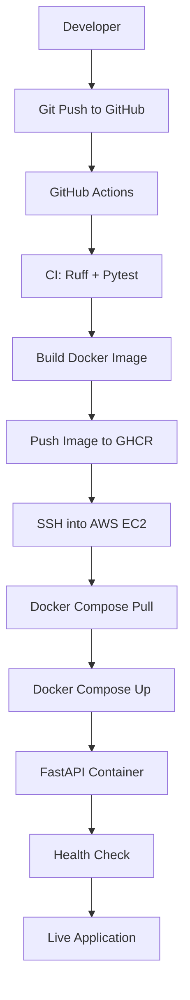

# 🚀 End-to-End CI/CD Pipeline with GitHub Actions, Docker & AWS EC2

An end-to-end CI/CD implementation that automates testing, Docker image building, publishing, and deployment of a FastAPI application to AWS EC2 using GitHub Actions.

The project demonstrates how to build an automated deployment workflow where every code push to the `main` branch can trigger a pipeline that validates the application, creates a Docker image, publishes it to GitHub Container Registry (GHCR), and deploys it to an AWS EC2 instance.

## 🎯 Project Overview

Manually deploying applications involves repetitive tasks such as running tests, building Docker images, pushing images to a registry, connecting to servers, and restarting containers.

This project automates that entire process using GitHub Actions.

**Key objectives:**
- Automate code quality checks and unit testing.
- Containerize the FastAPI application using Docker.
- Build and publish Docker images to GHCR.
- Deploy the latest application image to AWS EC2 over SSH.
- Verify deployment using an automated health check.

## 🏗️ Architecture



## ⚙️ CI/CD Pipeline

The GitHub Actions workflow consists of three main jobs.

### 1. Continuous Integration – Test

Runs on a GitHub-hosted Ubuntu runner.

- Checks out the repository.
- Sets up Python 3.12.
- Installs development dependencies.
- Runs Ruff linting.
- Validates code formatting.
- Executes automated tests using Pytest.

```bash
ruff check .
ruff format --check .
pytest -v --junitxml=test-results.xml
```

The pipeline proceeds only when the tests and quality checks pass.

### 2. Docker Build & Publish

After successful testing:

- Builds the application Docker image.
- Authenticates with GitHub Container Registry using `GITHUB_TOKEN`.
- Publishes the image to GHCR.
- Tags the image with the commit SHA and `latest`.

**Docker image:**

```text
ghcr.io/rohit2332000/end_to_end_github_actions:latest
```

### 3. Continuous Deployment – AWS EC2

GitHub Actions connects securely to the EC2 instance using SSH and GitHub repository secrets.

The deployment process executes:

```bash
cd /opt/fastapi-cicd

docker compose pull

docker compose up -d --remove-orphans
```

This downloads the latest image and starts the updated application container.

Finally, the workflow verifies deployment:

```bash
curl -fsS http://localhost:8000/health
```

## 🛠️ Tech Stack

| Category | Technologies |
|---|---|
| Backend | Python, FastAPI |
| Testing | Pytest, HTTPX |
| Code Quality | Ruff |
| CI/CD | GitHub Actions |
| Containerization | Docker |
| Container Orchestration | Docker Compose |
| Container Registry | GitHub Container Registry (GHCR) |
| Cloud Infrastructure | AWS EC2 |
| Operating System | Amazon Linux 2023 |
| Secure Deployment | SSH, GitHub Secrets |
| Version Control | Git, GitHub |

## 📁 Project Structure

```text
END_TO_END_gitHub_actions/
│
├── app/
│   ├── __init__.py
│   └── main.py
│
├── tests/
│   ├── __init__.py
│   └── test_main.py
│
├── .github/
│   └── workflows/
│       └── cicd.yml
│
├── Dockerfile
├── docker-compose.yml
├── requirements.txt
├── requirements-dev.txt
├── .dockerignore
├── .gitignore
└── README.md
```

## 🚀 Run Locally

### Prerequisites

- Python 3.12+
- Git
- Docker (optional for containerized execution)

### 1. Clone the repository

```bash
git clone https://github.com/Rohit2332000/END_TO_END_gitHub_actions.git

cd END_TO_END_gitHub_actions
```

### 2. Create a virtual environment

Windows:

```powershell
python -m venv venv
venv\Scripts\activate
```

Linux/macOS:

```bash
python3 -m venv venv
source venv/bin/activate
```

### 3. Install dependencies

```bash
pip install -r requirements-dev.txt
```

### 4. Run the application

```bash
uvicorn app.main:app --reload
```

Application:

```text
http://localhost:8000
```

Swagger documentation:

```text
http://localhost:8000/docs
```

### 5. Run automated tests

```bash
pytest -v
```

### 6. Run code quality checks

```bash
ruff check .
ruff format --check .
```

## 🐳 Run with Docker

### Build the Docker image

```bash
docker build -t fastapi-cicd-app .
```

### Run the container

```bash
docker run -d \
  --name fastapi-calculator \
  -p 8000:8000 \
  fastapi-cicd-app
```

### Verify the application

```bash
curl http://localhost:8000/health
```

## ☁️ AWS EC2 Deployment Setup

The application is deployed on an AWS EC2 instance running Amazon Linux 2023.

### EC2 Configuration

- EC2 instance with Amazon Linux 2023.
- Docker installed and running.
- Docker Compose plugin installed.
- Deployment directory: `/opt/fastapi-cicd`.
- Inbound network rules configured through the EC2 Security Group.

### Docker Compose Configuration

```yaml
services:
  fastapi:
    image: ghcr.io/rohit2332000/end_to_end_github_actions:latest
    container_name: fastapi-calculator
    ports:
      - "8000:8000"
    restart: unless-stopped
```

### GitHub Repository Secrets

Configure the following secrets under:

**GitHub Repository → Settings → Secrets and variables → Actions**

| Secret | Description |
|---|---|
| `EC2_HOST` | EC2 public IP address |
| `EC2_USER` | EC2 SSH username (`ec2-user`) |
| `EC2_SSH_KEY` | Complete EC2 private SSH key |

Never commit private SSH keys or credentials to your repository.

Ensure the GHCR package is public if the EC2 instance pulls images without registry authentication.

## 🔌 API Endpoints

| Method | Endpoint | Description |
|---|---|---|
| GET | `/` | Welcome endpoint |
| GET | `/health` | Application health check |
| POST | `/add` | Adds two numbers |
| POST | `/multiply` | Multiplies two numbers |

### Example Request

`POST /add`

```json
{
  "a": 10,
  "b": 20
}
```

Response:

```json
{
  "operation": "addition",
  "result": 30
}
```

## 🔄 Automated Deployment Lifecycle

Whenever new code is pushed to the `main` branch:

1. GitHub detects the push event.
2. GitHub Actions starts the CI/CD workflow.
3. Ruff validates code quality and formatting.
4. Pytest executes automated tests.
5. Docker builds a new application image.
6. GitHub Actions publishes the image to GHCR.
7. GitHub Actions connects to EC2 through SSH.
8. Docker Compose pulls and runs the updated image.
9. The health-check endpoint verifies the deployment.

This eliminates the need for manual image building, registry uploads, and application restarts.

## 🔐 Security Considerations

- SSH private keys are stored in GitHub Secrets.
- Private keys are excluded from version control.
- The Docker container runs as a non-root application user.
- EC2 inbound access is controlled through Security Groups.
- GHCR authentication uses GitHub Actions credentials.
- Production deployments should use HTTPS, restricted network access, and least-privilege credentials.

## 📈 Future Improvements

- Nginx reverse proxy and load balancing.
- HTTPS configuration using Let's Encrypt.
- Docker image rollback strategy.
- Prometheus and Grafana monitoring.
- Deployment notifications.
- Automated deployment health checks and recovery.
- AWS IAM-based deployment authentication.

## 👨‍💻 Author

**Rohit Yadav**

- GitHub: [Rohit2332000](https://github.com/Rohit2332000)
- LinkedIn: [Rohit Kumar Yadav](https://linkedin.com/in/rohit-kumar-yadav-42223a303/)
- Portfolio: [Personal Portfolio](https://rohit2332000.github.io/rohityadav.github.io/)

---

⭐ If you find this project useful, consider giving the repository a star!

**Built to understand and implement real-world CI/CD automation using GitHub Actions, Docker, and AWS EC2.**